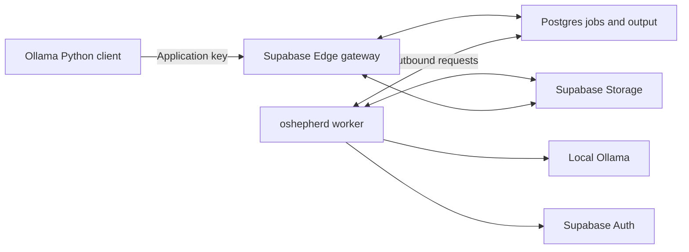
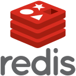
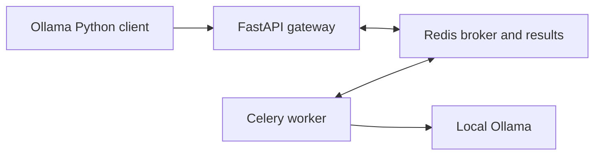

# oshepherd

<p align="center">
  
  &nbsp;&nbsp;&nbsp;<b>+</b>&nbsp;&nbsp;&nbsp;
  <a href="https://supabase.com">
    
  </a>
</p>

<p align="center">
  <a href="https://pypi.org/project/oshepherd/"></a>
  <a href="https://deepwiki.com/mnemonica-ai/oshepherd"></a>
  <a href="https://socket.dev/pypi/package/oshepherd"></a>
  <a href="https://github.com/mnemonica-ai/oshepherd/actions/workflows/contract-tests.yaml"></a>
  <a href="https://discord.gg/99xEZmZYt9"></a>
  <a href="LICENSE"></a>
</p>

Distributed inference for your Ollama servers, using **Supabase as the primary
broker**. Point the official Ollama Python client at one gateway and let
oshepherd route requests to your connected workers. Models and inference stay on
your machines; prompts, jobs and results pass through Supabase.

**Choose a walkthrough:**

| Example | Where Supabase runs | Needs | Guide |
| --- | --- | --- | --- |
| Fully local | Docker containers on your machine, including Studio | Python 3.12, uv, Docker, Supabase CLI **2.116.0**, `psql`, Ollama | [Local walkthrough](docs/supabase-walkthrough.md) |
| Supabase Cloud | Hosted project created by `oshepherd share`; Ollama stays on your machine | Python 3.12, uv, a Supabase account, Ollama | [Cloud walkthrough](docs/supabase-cloud-walkthrough.md) |

Both examples cover setup, Python requests, database inspection and restart.
Once an installation is running, follow the [worker onboarding walkthrough](docs/supabase-worker-walkthrough.md)
to add an Ollama server and [watch its logs](docs/supabase-worker-walkthrough.md#watch-worker-logs),
the [client onboarding walkthrough](docs/supabase-client-walkthrough.md)
to give a script its own credentials, or the [operations guide](docs/setup-supabase.md)
to run in the background, restart or disable an installation.

Supabase support is experimental and published as the `0.1.0rc1` release
candidate: `uv tool install --python 3.12 'oshepherd[supabase]==0.1.0rc1'`. See the
[documentation index](docs/README.md) for installation, operations, database
references and development guides, and the [progress ledger](docs/plans/supabase/progress.md)
for validation status.

## Architecture

Supabase is the broker. Postgres coordinates durable jobs and worker leases,
Auth gives each worker a restricted identity, Storage holds larger results, and
an Edge Function exposes the inference API to Ollama clients.



1. A client sends an Ollama request to the Edge gateway with its application key.
2. The gateway records a job in Postgres.
3. A worker claims the job under a lease, runs it on its local Ollama, and writes
   output back to Postgres, or to Storage when the result is large.
4. The gateway returns the result, or streams it, to the client.

Workers make only outbound connections to Supabase. A hosted installation does
not need an inbound port or tunnel to Ollama. The same SQL, Auth, Storage and
Edge path can be tested first with local Supabase containers.

## Legacy implementation: Redis, Celery and FastAPI

<p align="center">
  <a href="https://redis.io">
    
  </a>
  &nbsp;&nbsp;
  <a href="https://docs.celeryq.dev">
    
  </a>
  &nbsp;&nbsp;
  <a href="https://fastapi.tiangolo.com">
    
  </a>
</p>

oshepherd's original architecture is self-hosted: a FastAPI server receives
Ollama requests and queues them as Celery tasks in Redis, which is both the
message broker and the result backend. Celery workers, one next to each Ollama
server, take tasks from the queue and run them on their local models. You run and
secure all three parts yourself.



| Area | Supabase (primary) | Redis, Celery and FastAPI (legacy) |
| --- | --- | --- |
| Start serving | `oshepherd share` / prepared local connection | `start-api` and `start-worker` |
| Add workers | `invite`, then `join` with a private one-use invitation | Configure the worker's Redis connection |
| Python client | Gateway URL plus application bearer key | FastAPI URL |
| Run infrastructure | Supabase; Ollama stays local | Redis, Celery and FastAPI |
| Guide | [Local](docs/supabase-walkthrough.md) / [Cloud](docs/supabase-cloud-walkthrough.md) | [Redis setup](docs/setup-redis.md) |

The legacy stack remains supported. Existing `start-api` and `start-worker`
commands retain their Redis defaults; choosing Supabase does not migrate Redis
jobs or switch an existing deployment automatically.

### Motivation

oshepherd started as a way to give the kids at [CodePeques](https://codepeques.com/),
a technology academy in Venezuela that teaches children programming, robotics and
design, access to large language models. Hosted LLM APIs such as OpenAI, Anthropic
and Gemini were not available in Venezuela because of US sanctions, and deploying
a custom model in the cloud was too expensive. Instead, oshepherd pooled the
machines already on hand, each running open-source models with Ollama, behind one
API. That setup [served CodePeques classes and CodePeques Day in May 2024, with no
orchestration or inference costs](https://speakerdeck.com/p1nox/beyond-the-cloud-on-premise-orchestration-for-open-source-llms?slide=7).

### PyCon Austria 2025

The legacy stack was presented at PyCon Austria 2025 in the talk
["Beyond the Cloud: On-Premise Orchestration for Open-Source LLMs"](https://2025.pycon.at/talks/beyond-the-cloud-on-premise-orchestration-for-open-source-llms/).
For a practical example of orchestrating on-premise open-source LLMs with
oshepherd, see the companion material:

- Repository: https://github.com/mnemonica-ai/on-premise-orchestration-os-llms
- Deck: https://speakerdeck.com/p1nox/beyond-the-cloud-on-premise-orchestration-for-open-source-llms

## Use the Ollama Python package

`client.json` contains the gateway URL and your private application key. The URL
includes `/functions/v1/ollama`; it is not the database REST endpoint.
This example uses the manual local walkthrough's state directory. For cloud,
use `.oshepherd/cloud/first-run/client.json`, or use a named client's export.

```python
import json
from pathlib import Path
from ollama import Client

settings = json.loads(Path(
    ".oshepherd/local/end-user/operator/client.json"
).read_text())
client = Client(
    host=settings["gateway_url"],
    headers={"Authorization": "Bearer " + settings["application_key"]},
    timeout=145,
)

for chunk in client.chat(
    model="llama3.2:3b",
    messages=[{"role": "user", "content": "Say hello in one sentence."}],
    options={"num_predict": 32},
    stream=True,
):
    print(chunk.message.content or "", end="", flush=True)
```

Both `Client` and `AsyncClient` are exercised in the local acceptance workflow.
The supported routes match the existing Redis endpoint set:

| Operation | Route | Python client |
| --- | --- | --- |
| Generate, JSON or streaming | `POST /api/generate` | `generate()` |
| Chat, JSON or streaming | `POST /api/chat` | `chat()` |
| Legacy embeddings | `POST /api/embeddings` | `embeddings()` |
| System One decisions | `POST /v1/systemone` | `systemone()` |
| Available models | `GET /api/tags` | `list()` |
| Running models | `GET /api/ps` | `ps()` |
| Model information | `POST /api/show` | `show()` |
| Version | `GET /api/version` | Authenticated HTTP request |
| Gateway health | `GET /health` | Authenticated HTTP request |

This is the existing oshepherd API contract, not full upstream Ollama parity.
`embed()` (`/api/embed`), model pull/create/delete and additional request fields
are outside this milestone. The existing show response wraps upstream model
information inside `model_info`. Legacy embeddings accepts the Python SDK's
`prompt` as well as `input`.

System One requires a compatible installed decision model. Models advertising
the `decision` capability are registered automatically. The
[acceptance guide](docs/setup-supabase-local.md#endpoint-scope-and-limits)
explains how to include real decision inference in validation.

## Current limits and remaining work

Synchronous requests have a 135-second budget, including queueing and model
loading. Edge request/response bodies are capped at 1 MiB. The asynchronous
`/jobs` API supports longer work and results up to 32 MiB, using a separate client
flow. Closing a streaming client does **not yet reliably cancel** inference
through the Edge proxy; this remains a release qualification gate.

See the [remaining plan](docs/plans/supabase/next-steps.md),
[compatibility matrix](docs/plans/supabase/compatibility.md) and
[progress ledger](docs/plans/supabase/progress.md). Supabase is the primary
workflow, but the candidate is not production-qualified.

## Development

```sh
uv sync --locked --extra supabase --extra installer
uv run --locked pytest -q tests/contracts tests/test_systemone.py
# After changing packaged Python or Edge sources:
uv run --locked python -m scripts.build_supabase_release
uv build
```

Keep SQL migrations immutable. Refresh the release manifest after source changes
before running release-integrity tests. `uv.lock` records dependency versions;
`requirements/runtime.txt` is the locked runtime export used for clean candidate
verification. [Installation](docs/install.md) covers local wheel testing. The
[disposable acceptance workflow](docs/setup-supabase-local.md) tests a fresh stack
and removes its own test database when it finishes.

The [local integration runbook](docs/plans/supabase/experiments/local-edge-lifecycle.md)
covers the isolated development stack and its strict disconnect test. The
[operator runbook](docs/plans/supabase/experiments/operator-lifecycle.md) covers
upgrade, diagnostics, rotation, revocation and disablement. Redis tests and
startup instructions remain in the [legacy guide](docs/setup-redis.md).

Contributions are welcome through [issues](https://github.com/mnemonica-ai/oshepherd/issues)
and [pull requests](https://github.com/mnemonica-ai/oshepherd/pulls).

Developed by [mnemonica.ai](https://mnemonica.ai). [MIT license](LICENSE).
Supabase's unmodified logo comes from its [official brand assets](https://supabase.com/brand).
The Redis and FastAPI logos come from [Devicon](https://github.com/devicons/devicon);
the Celery logo comes from its official project repository.
