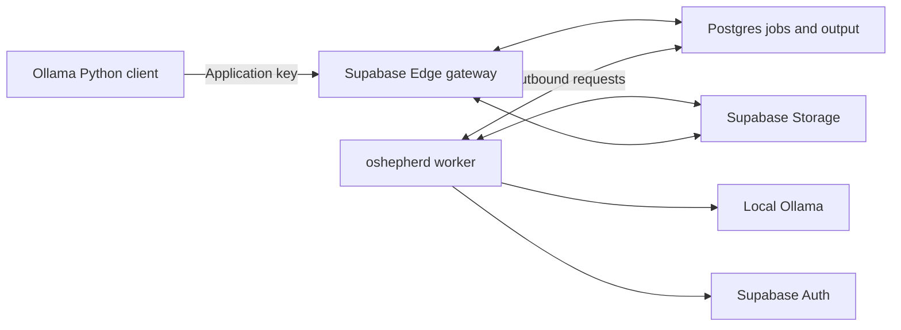

# oshepherd

<p align="center">
  
  <a href="https://supabase.com">
    
  </a>
</p>

Distributed inference for your Ollama servers, using **Supabase as the primary
broker**. Point the official Ollama Python client at one gateway and let
oshepherd route requests to your connected workers. Models and inference stay on
your machines; prompts, jobs and results pass through Supabase.

**Start with the [Supabase walkthrough](docs/supabase-walkthrough.md):** create a
clean local Docker stack, connect local Ollama, send Python requests, and onboard
another server. This branch is an experimental, unpublished candidate. PyPI
publication is outside the current milestone. The latest full local reruns hit
an Edge CPU limit on the joined worker (HTTP 503/546); see
[validation status](docs/plans/supabase/progress.md#branch-cleanup-follow-up).

## Moving from Redis to Supabase

The original architecture uses a FastAPI gateway, Celery and Redis. Supabase now
provides the main development and onboarding path: Postgres coordinates durable
jobs and worker leases, Auth gives each worker a restricted identity, Storage
holds larger results, and an Edge Function exposes the inference API.



Workers make outbound connections to Supabase. A hosted installation does not
need an inbound port or tunnel to Ollama. The same SQL, Auth, Storage and Edge
path can be tested first with local Supabase containers.

| Area | Supabase primary workflow | Redis legacy workflow |
| --- | --- | --- |
| Start serving | `oshepherd share` / prepared local connection | `start-api` and `start-worker` |
| Add workers | `invite`, then `join` with a private one-use invitation | Configure the worker's Redis connection |
| Python client | Gateway URL plus application bearer key | FastAPI URL |
| Run infrastructure | Supabase; Ollama stays local | FastAPI, Celery and Redis |
| Guide | [Supabase walkthrough](docs/supabase-walkthrough.md) | [Redis setup](docs/setup-redis.md) |

Redis remains supported as a legacy option. Existing `start-api` and
`start-worker` commands retain their Redis defaults; choosing Supabase does not
migrate Redis jobs or switch an existing deployment automatically.

## Try it locally

From this checkout, with Python 3.12, uv, Docker, Supabase CLI **2.116.0**, `psql`
and Ollama available:

```sh
uv sync --locked --extra supabase

# Download these only if you do not already have compatible models installed.
ollama pull llama3.2:3b
ollama pull embeddinggemma:latest

uv run --locked python -m scripts.supabase_local_acceptance \
  --work-dir "$PWD/.oshepherd/local/first-run" --serve
```

Use a new work directory for each run. The runner installs into a fresh database,
checks the first worker, invites a second local Ollama server, and verifies its
saved-session restart. `--serve` leaves the test installation running for your
own requests. Ctrl-C removes its disposable stack and database while preserving
private logs and unrelated services.

In a second terminal:

```sh
uv run --locked python examples/supabase_client.py \
  --client-file .oshepherd/local/first-run/operator/client.json \
  --model llama3.2:3b --embedding-model embeddinggemma:latest
```

The [walkthrough](docs/supabase-walkthrough.md) explains each CLI step, a persistent
manual setup, invitations, troubleshooting and the hosted setup path.

## Use the Ollama Python package

`client.json` contains the gateway URL and your private application key. The URL
includes `/functions/v1/ollama`; it is not the database REST endpoint.

```python
import json
from pathlib import Path
from ollama import Client

settings = json.loads(Path(
    ".oshepherd/local/first-run/operator/client.json"
).read_text())
client = Client(
    host=settings["gateway_url"],
    headers={"Authorization": "Bearer " + settings["application_key"]},
    timeout=145,
)

for chunk in client.chat(
    model="llama3.2:3b",
    messages=[{"role": "user", "content": "Say hello in one sentence."}],
    options={"num_predict": 32},
    stream=True,
):
    print(chunk.message.content or "", end="", flush=True)
```

Both `Client` and `AsyncClient` are exercised in the local acceptance workflow.
The supported routes match the existing Redis endpoint set:

| Operation | Route | Python client |
| --- | --- | --- |
| Generate, JSON or streaming | `POST /api/generate` | `generate()` |
| Chat, JSON or streaming | `POST /api/chat` | `chat()` |
| Legacy embeddings | `POST /api/embeddings` | `embeddings()` |
| System One decisions | `POST /v1/systemone` | `systemone()` |
| Available models | `GET /api/tags` | `list()` |
| Running models | `GET /api/ps` | `ps()` |
| Model information | `POST /api/show` | `show()` |
| Version | `GET /api/version` | Authenticated HTTP request |
| Gateway health | `GET /health` | Authenticated HTTP request |

This is the existing oshepherd API contract, not full upstream Ollama parity.
`embed()` (`/api/embed`), model pull/create/delete and additional request fields
are outside this milestone. The existing show response wraps upstream model
information inside `model_info`. Legacy embeddings accepts the Python SDK's
`prompt` as well as `input`.

System One requires a compatible installed decision model. Real `tev1:4b`
inference has passed through local Supabase, both local servers and worker
restart. A later rerun hit an Edge CPU limit on the joined server
(HTTP 503); resource qualification remains open. Add `--decision-model tev1:4b` to the acceptance command to include it;
models advertising the `decision` capability are registered automatically.

## Current limits and remaining work

Fresh Docker setup, CLI installation, real generate/chat/embeddings/System One,
second-server onboarding and restart have passed locally. The two Ollama servers
in that test run on the same machine. The latest reruns failed at the joined-worker stage because Edge exhausted its
CPU budget. Physical second-machine networking and the full fresh hosted-project
wizard also still need acceptance.

Synchronous requests have a 135-second budget, including queueing and model
loading. Edge request/response bodies are capped at 1 MiB. The asynchronous
`/jobs` API supports longer work and results up to 32 MiB, using a separate client
flow. Closing a streaming client does **not yet reliably cancel** inference
through the Edge proxy; this remains a release qualification gate.

See the [remaining plan](docs/plans/supabase/next-steps.md),
[compatibility matrix](docs/plans/supabase/compatibility.md) and
[progress ledger](docs/plans/supabase/progress.md). Supabase is the primary
workflow, but the candidate is not production-qualified.

## Development

```sh
uv sync --locked --extra supabase
uv run --locked pytest -q tests/contracts tests/test_systemone.py
# After changing packaged Python or Edge sources:
uv run --locked python -m scripts.build_supabase_release
uv build
```

Keep SQL migrations immutable. Refresh the release manifest after source changes
before running release-integrity tests. `uv.lock` records dependency versions;
`requirements/runtime.txt` is the locked runtime export used for clean candidate
verification. [Installation](docs/install.md) covers local wheel testing.

The [local integration runbook](docs/plans/supabase/experiments/local-edge-lifecycle.md)
covers the isolated development stack and its strict disconnect test. The
[operator runbook](docs/plans/supabase/experiments/operator-lifecycle.md) covers
upgrade, diagnostics, rotation, revocation and disablement. Redis tests and
startup instructions remain in the [legacy guide](docs/setup-redis.md).

Contributions are welcome through [issues](https://github.com/mnemonica-ai/oshepherd/issues)
and [pull requests](https://github.com/mnemonica-ai/oshepherd/pulls).

Developed by [mnemonica.ai](https://mnemonica.ai). [MIT license](LICENSE).
Supabase's unmodified logo comes from its [official brand assets](https://supabase.com/brand).
